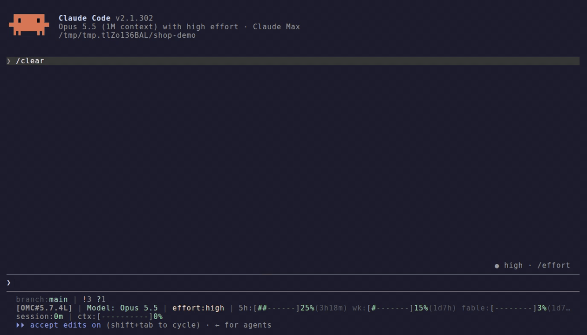

# consensus-review

[](https://github.com/akholod/consensus-review/actions/workflows/ci.yml)
[](https://github.com/akholod/consensus-review/releases)
[](https://www.npmjs.com/package/consensus-review)
[](https://github.com/akholod/consensus-review/blob/main/LICENSE)

Code review for Claude Code that a second model has to agree with.

## The problem

Ask one model to review a change and you get one opinion. It locks onto
the first theme it notices, misses what sits beside it, and reports
guesses with the same confidence as bugs. A 2000-line dump of generated
configs gets the same expensive treatment as a 20-line change to auth.

## What it does

It reviews a pull request or your uncommitted changes in four
dimensions: architecture, quality, impact and tests. Two strategies:

- **`/consensus-review`** runs a panel in parallel: Claude reviewers for
  each dimension plus one independent consultant: [`codex`](https://github.com/openai/codex),
  else `pi`, else a separate read-only `claude -p`. An arbiter merges what they found and shows
  who agreed on each finding.
- **`/loop-review`** builds the context once and reviews it in several
  passes. Each pass is told what is already covered, never why, so it
  looks somewhere else instead of repeating the last pass.

Both rank findings **P0** (blocker), **P1** (important) and **P2**
(minor), and both demand evidence: a P0 or P1 needs a concrete failure
scenario, or it is not a P0 or P1. Then a verifier with a fresh context,
which found nothing itself, tries to refute the serious findings before
you see them.

Project rules live in the repository as review lenses in
`.consensus-review/lenses/`; see [Project lenses](https://github.com/akholod/consensus-review/blob/main/docs/consensus-review.md#project-lenses).
Named presets of settings live in `.consensus-review/profiles/` and apply with `profile=<name>`; see [Profiles](https://github.com/akholod/consensus-review/blob/main/docs/consensus-review.md#profiles).

Reviews never change your code. They write only the report and its private run archive in the ignored
`.reviews/`; `/consensus-review:profile` writes only the profile you name. `archive=off` drops the archive (`--no-archive` does the same for `/loop-review`); `no-file` writes nothing at all.

<p align="center">
  
</p>

One command, three Claude reviewers and codex at once. A sceptic pass
tries to refute every serious finding before the report is written.

## Install

Paste this into Claude Code:

```text
Install and set up the consensus-review plugin by following https://raw.githubusercontent.com/akholod/consensus-review/main/docs/install.md
```

It installs the plugin, checks which consultants you have, and runs the
doctor to show what works.

Or by hand:

```text
/plugin marketplace add akholod/consensus-review
/plugin install consensus-review@crv
```

For development, add a local clone instead:
`/plugin marketplace add /path/to/consensus-review`.

Commands install namespaced (`/consensus-review:loop-review`); the bare
name works when no other command has it. The doctor always needs the
namespace, because Claude Code has a `/doctor` of its own.

Then run `/consensus-review:doctor`. For the full panel you also want `codex` (logged in), `gh` for
pull requests, and [`codegraph`](https://github.com/colbymchenry/codegraph)
for fast blast-radius. None of them is required; see
[docs/install.md](https://github.com/akholod/consensus-review/blob/main/docs/install.md) for what each one adds.

## How it looks in practice

```text
/consensus-review                     review uncommitted changes
/consensus-review #42                 review pull request 42
/consensus-review #42 deep lang=uk    full panel, report in Ukrainian
/loop-review --pr=42                  sequential review of the same PR
```

The report goes to the terminal and to `.reviews/`. Each finding carries
its location, severity, a failure scenario and an agreement badge such
as `[claude|codex]`. Its header says which sources ran, so a review that
lost its consultant says so instead of looking complete. The header also
names the consultant and why it was chosen. `claude-cli` is independent
in context but not in model; agreement is counted per model family, so
`[claude|claude-cli]` is one source.

Small changes stay cheap: a triage step sizes the change and its blast
radius first, and a docs-only diff skips the panel entirely.

## Commands

| Command                     | Does                                                         |
| --------------------------- | ------------------------------------------------------------ |
| `/consensus-review`         | panel, arbiter, consultant (codex→pi→claude-cli), sceptic    |
| `/loop-review`              | sequential passes with evidence per risk cell                |
| `/impact-review`            | correctness, regressions, security, the code around the diff |
| `/quality-review`           | conventions, duplication, AI slop, contracts                 |
| `/test-review`              | whether the tests catch realistic regressions                |
| `/arch-review`              | architectural impact of the change                           |
| `/architecture-audit`       | the whole project's architecture, not just a diff            |
| `/consensus-review:doctor`  | what a broken setup would silently do to a review            |
| `/consensus-review:profile` | create, update or list review profiles                       |

The diff reviews take an empty scope (your working tree) or a pull
request: a URL, `owner/repo#N` or `#N` (`--pr=<n>` for `/loop-review`).
Flags: [docs/consensus-review.md](https://github.com/akholod/consensus-review/blob/main/docs/consensus-review.md) and
[docs/loop-review.md](https://github.com/akholod/consensus-review/blob/main/docs/loop-review.md).

## Which one to use

- You want to know whether a change is safe to merge, with several
  sources agreeing: `/consensus-review`.
- You want broad coverage at a lower cost per token, and a `CLEAN` you
  can trust: `/loop-review`. It can only report `CLEAN` when every pass
  succeeded and every risk cell was covered with evidence; that rule is
  in code, not in a prompt.
- You want one angle only: the single-dimension commands.

## Profiles

A profile is a named set of settings, kept in the repository and
applied with `profile=<name>`. Flags still win over it, and the report's
`Settings:` line names where each value came from. There is no implicit
default profile: without `profile=`, the built-in defaults apply.

```text
/consensus-review:profile                       # built-in defaults, then your profiles
/consensus-review:profile quick depth=minimal dims=+quality sceptic=basic effort=verifier:medium,impact:medium
/consensus-review:profile release depth=deep extra=pi timeout=1200 models=verifier:fable effort=verifier:high,impact:high,architecture:high
/consensus-review profile=release <PR-url>
```

A profile applies only once it is committed and unchanged: a profile the
reviewed change adds or edits stops the run instead of configuring its
own review.

Default model and effort per role, which `models=` and `effort=` can
override per run or per profile:

| Role               | Model   | Effort |
| ------------------ | ------- | ------ |
| `finding-verifier` | opus    | high   |
| `impact-reviewer`  | opus    | high   |
| `arch-reviewer`    | opus    | medium |
| `quality-reviewer` | sonnet  | high   |
| `test-reviewer`    | sonnet  | high   |

The arbiter runs on your session's model (`/model`). See
[Profiles](https://github.com/akholod/consensus-review/blob/main/docs/consensus-review.md#profiles)
and [Models](https://github.com/akholod/consensus-review/blob/main/docs/models.md).

## Docs

- [Install](https://github.com/akholod/consensus-review/blob/main/docs/install.md): step by step, written for an agent but fine by hand.
- [consensus-review](https://github.com/akholod/consensus-review/blob/main/docs/consensus-review.md): flags, triage tiers, how findings are merged and verified.
- [loop-review](https://github.com/akholod/consensus-review/blob/main/docs/loop-review.md): passes, coverage cells, terminal states, cost.
- [Models](https://github.com/akholod/consensus-review/blob/main/docs/models.md): which model each part runs on, and how to change it.
- [Troubleshooting](https://github.com/akholod/consensus-review/blob/main/docs/troubleshooting.md): what the doctor's warnings mean.
- [Changelog](https://github.com/akholod/consensus-review/blob/main/CHANGELOG.md).

## What it runs and sends

Everything the plugin runs, and where your code goes:

- **Your code goes to the models you already use.** The Claude agents
  run in your Claude Code session. `/consensus-review` gives the diff
  and a short brief to `codex exec` (through the lane helper below),
  which runs in a read-only sandbox, reads files in your repository,
  and sends what it reads to OpenAI under your codex login. Without
  codex, the consultant is `pi`, else `claude-cli`: a separate
  `claude -p` with a read-only toolset that sends what it reads to
  Anthropic and uses your Claude quota. With
  `extra=pi`, `pi` does the same with a read-only toolset and the
  provider pi is set up for. pi runs without extensions, skills, context
  files or a saved session, so a provider that only an extension supplies
  (such as `claude-bridge`) is not available to it. `/loop-review` runs `claude -p`, which
  sends the diff and its context to Anthropic.
- **GitHub, for pull requests.** `gh pr diff` and `gh pr view` read the
  PR. Without `gh`, a local clone is used (it needs `base=<branch>`),
  or for a public repository the diff is fetched with `curl` from the
  PR's own host. No token is read from your environment.
- **Local tools.** `git` (read-only commands), and `codegraph` or
  `graphify` when they are installed.
- **The doctor** asks GitHub for the latest release and, unless run with
  `offline`, makes one small `claude -p` call and one `codex exec` call
  on a built-in sample diff.
- **Writes.** The report in `.reviews/` (or `out=<path>`, or nothing with
  `no-file`), and working files in a temp directory outside your
  repository.
- **The run archive.** Next to the report, `.reviews/<run-id>/` keeps the
  diff, the prompts and the consultants' transcripts (which can include
  any repo file a model read). It is private (`0700`/`0600`), written
  only when git ignores `.reviews/`, and never leaves your repository.
  Turn it off with `archive=off` (`--no-archive` for `/loop-review`);
  `no-file` writes none. There is no retention: delete old runs yourself.

The plugin has no telemetry and makes no other network call of its own.
The Claude agents run with your session's tools and permissions, minus
`Write` and `Edit`.

## Under the hood

The panel is plain Claude Code: commands and read-only subagents
(`disallowedTools: Write, Edit`), plus one small Node helper
(`scripts/run-lane.mjs`) that runs `codex` and `pi` with their read-only
flags (`pi`: `--tools read,grep,find,ls --no-mcp --no-extensions
--no-session --no-skills --no-prompt-templates --no-context-files
--no-approve`), retries a failed run
once and kills its process group on timeout. `/loop-review` is a small
Node runtime with no dependencies. Its passes run as separate
`claude -p` processes with every file, shell, web and MCP tool removed,
so a pass sees only the context it was given. Both strategies share one finding schema
(`contracts/finding.schema.json`) and one set of severity bars
(`contracts/severity-bars.md`); CI fails if a prompt drifts from them.

Design notes and measurements behind these choices live in
[docs/design/](https://github.com/akholod/consensus-review/tree/main/docs/design). Releasing: [docs/RELEASING.md](https://github.com/akholod/consensus-review/blob/main/docs/RELEASING.md).

## License

MIT, see [LICENSE](https://github.com/akholod/consensus-review/blob/main/LICENSE).

`codex`, `pi`, `codegraph` and `graphify` are separate tools. They are
not bundled; the plugin detects and calls them when you install them.
